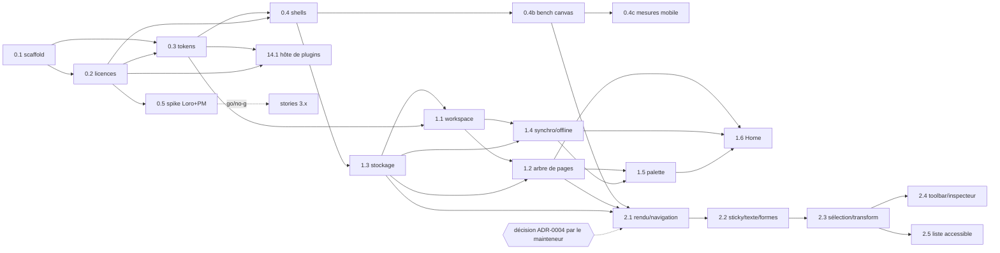

# Stories prêtes pour le développement (S0 à S2 + 14.1)

Chaque fichier est **autonome** (contexte copié, chemins, tâches ordonnées, critères Given/When/Then, tests, commandes exactes, portes de qualité, interdits, définition de terminé, questions au mainteneur) et dimensionné pour **une session d'agent** local (contexte 262 144 tokens ; ≈ 5 000 tokens par fichier). Source des stories : `_bmad-output/planning-artifacts/epics.md` ; statuts : `../sprint-status.yaml` (champ `story_file`).

Le développement démarre **vendredi 13 nov. 2026** (S0 officiel : 16 nov.). Préfixe de crates : **`ubao-*`** (story 0.1 renomme `crates/wiro-*`), à confirmer par le mainteneur avant l'exécution de 0.1.

## Index

| Id | Fichier | Titre | Sprint | Taille | Dépend de |
|---|---|---|---|---|---|
| 0.1 | [story-0.1-monorepo-scaffold.md](story-0.1-monorepo-scaffold.md) | Monorepo scaffold | S0 | L | - |
| 0.2 | [story-0.2-licence-clean-room-gate.md](story-0.2-licence-clean-room-gate.md) | Licence & clean-room gate | S0 | M | 0.1 |
| 0.3 | [story-0.3-design-tokens-pipeline.md](story-0.3-design-tokens-pipeline.md) | Design tokens pipeline | S0 | M | 0.1, 0.2 |
| 0.4 | [story-0.4-tauri-shells.md](story-0.4-tauri-shells.md) | Tauri 2 shell desktop (Windows, macOS) | S0 | L | 0.1, 0.2, 0.3 |
| 0.4b | [story-0.4b-bench-canvas.md](story-0.4b-bench-canvas.md) | Bench canvas (ADR-0004) | S0 | L | 0.4 |
| 0.4c | [story-0.4c-mesures-mobile.md](story-0.4c-mesures-mobile.md) | ~~Mesures mobile (ADR-0008)~~ — dropped 2026-11-11 | S0 | — | — |
| 0.5 | [story-0.5-loro-prosemirror-spike.md](story-0.5-loro-prosemirror-spike.md) | Spike Loro + ProseMirror | S0 | M | 0.1, 0.2 |
| 1.3 | [story-1.3-crash-safe-local-storage.md](story-1.3-crash-safe-local-storage.md) | Crash-safe local storage | S1 | L | 0.1, 0.2, 0.4 |
| 1.1 | [story-1.1-workspace-and-spaces.md](story-1.1-workspace-and-spaces.md) | Workspace & spaces (+ fondation UI/i18n) | S1 | L | 0.1-0.4, 1.3 |
| 1.2 | [story-1.2-page-tree-sidebar.md](story-1.2-page-tree-sidebar.md) | Page tree & sidebar | S1 | L | 1.1, 1.3 |
| 1.4 | [story-1.4-sync-status-offline-ux.md](story-1.4-sync-status-offline-ux.md) | Sync status & offline UX | S1 | M | 1.1, 1.3 |
| 1.5 | [story-1.5-command-palette.md](story-1.5-command-palette.md) | Command palette | S1 | M | 1.2, 1.4 |
| 1.6 | [story-1.6-home.md](story-1.6-home.md) | Home | S1 | M | 1.2, 1.4, 1.5 |
| 2.1 | [story-2.1-render-navigate.md](story-2.1-render-navigate.md) | Render & navigate | S2 | L | 0.4b (+ décision ADR-0004), 1.2, 1.3 |
| 2.2 | [story-2.2-stickies-text-shapes.md](story-2.2-stickies-text-shapes.md) | Stickies, text, shapes | S2 | L | 2.1 |
| 2.3 | [story-2.3-selection-transform.md](story-2.3-selection-transform.md) | Selection & transform | S2 | L | 2.2 |
| 2.4 | [story-2.4-quick-toolbar-inspector.md](story-2.4-quick-toolbar-inspector.md) | Quick toolbar & inspector | S2 | M | 2.3 |
| 2.5 | [story-2.5-accessible-object-list.md](story-2.5-accessible-object-list.md) | Accessible object list | S2 | M | 2.3 |
| 14.1 | [story-14.1-plugin-host-minimal.md](story-14.1-plugin-host-minimal.md) | Plugin host (version minimale) | S4 (préparée tôt) | L | 0.1, 0.2, 0.3 |

Notes : 0.4b et 0.4c découpent le « perf spike 0.4b » de l'ADR-0004 et les mesures de l'ADR-0008 (absents de `sprint-status.yaml`, qui n'a pas été étendu). 1.3 passe **avant** 1.1 (la création d'un workspace doit persister hors ligne). 14.2 n'est pas écrite ici.

## Graphe de dépendances



## Ordre d'exécution recommandé

**Un seul agent (séquentiel, recommandé vendredi)** : 0.1 → 0.2 → 0.3 → 0.5 → 0.4 → 0.4b → 1.3 → 1.1 → 1.2 → 1.4 → 1.5 → 1.6 → (décision ADR-0004) → 2.1 → 2.2 → 2.3 → 2.4 → 2.5. 14.1 et 0.4c s'insèrent quand le mainteneur a du temps pour les relire (14.1 n'a aucune dépendance au-delà de 0.3 ; 0.4c exige des appareils réels).

| Vague | Stories | Parallélisme possible (worktrees séparés, un agent chacun) |
|---|---|---|
| S0-a | 0.1 | aucun (tout en dépend) |
| S0-b | 0.2, 0.3 | 0.2 ∥ 0.3 (fichiers disjoints ; 0.3 compare ses licences à 0.2 une fois mergée) |
| S0-c | 0.5, 0.4 | 0.5 ∥ 0.4 (0.5 = `tools/spikes`, 0.4 = Tauri/WASM) ; 14.1 peut démarrer ici |
| S0-d | 0.4b, 0.4c | 0.4c après 0.4b ; runs sur appareils par le mainteneur |
| S1-a | 1.3 | aucun (bloque 1.1, 1.2, 1.4, 2.1) |
| S1-b | 1.1 | aucun (fondation UI/i18n) |
| S1-c | 1.2, 1.4 | 1.2 ∥ 1.4 (fichiers disjoints, rebase attendu sur `locales/*.ftl`) |
| S1-d | 1.5, 1.6 | 1.5 avant 1.6 |
| S2-a | 2.1 | **porte** : décision ADR-0004 |
| S2-b | 2.2 → 2.3 | séquentiel |
| S2-c | 2.4, 2.5 | 2.4 ∥ 2.5 |

Conflits probables en parallèle : `locales/*/app.ftl`, `crates/ubao-wasm/src/lib.rs`, `apps/web/src/shell/*`, `pnpm-lock.yaml`, `Cargo.lock` : le second agent rebase avant sa PR ; ne jamais résoudre un conflit de lockfile à la main (régénérer).

## Prérequis humains avant vendredi (sinon l'agent s'arrête sur « À demander »)
1. Préfixe de crates `ubao-*` (0.1). 2. Exceptions de licence : `Apache-2.0 WITH LLVM-exception`, `Unicode-3.0`, `0BSD`, `CC0-1.0` (0.2) ; dépendances MPL-2.0 transitives de Tauri (0.4) ; `axe-core` MPL-2.0 en dev (2.5). 3. Biome vs ESLint/Prettier (0.1) ; Tailwind/Radix/Fluent (1.1). 4. Comptes de signature Apple/Android/Windows (0.4, ADR-0009). 5. Appareils de mesure M1-M5, D1-D4 (0.4b, 0.4c). 6. ADR-0004 à trancher après 0.4b ; ADR-0010 « proposed » (14.1 = prototype réversible tant que non accepté). 7. Nouveaux chemins à ajouter à `project-structure.md` : `crates/ubao-wasm`, `crates/ubao-tokens`, `crates/ubao-plugin-host`, `packages/storage`, `packages/plugin-schema`, `packages/plugin-host`, `apps/desktop/src-tauri`, `tools/bench/canvas`, `tools/spikes`.

## Modèle de prompt court pour l'agent Qwen (une story)

Prompt système : contenu du bloc de [`_qwen-agent-prompt.md`](_qwen-agent-prompt.md). Message utilisateur :

```text
Exécute la story : _bmad-output/implementation-artifacts/stories/story-<ID>-<SLUG>.md
Branche : feat/<ID-avec-tirets>-<SLUG> depuis main à jour (jamais de push sur main).
Respecte tâches, critères d'acceptation, tests et portes de qualité de la story. Conventional Commits, PR obligatoire.
Stop immédiat sur toute porte rouge non résolue en 3 essais, ou sur tout point « À demander au mainteneur » : résume le blocage et attends.
Ne modifie pas sprint-status.yaml, les ADR ni AGENTS.md. Clean-room : aucun code de tldraw/AFFiNE/BlockSuite/Excalidraw/Miro ; licences MIT/Apache/BSD/ISC/Zlib seulement.
```

Après la PR : le mainteneur relit, fusionne, puis passe le statut dans `sprint-status.yaml` (`ready-for-dev` → `in-progress` → `review` → `done`) ; l'agent ne touche pas ce fichier.
