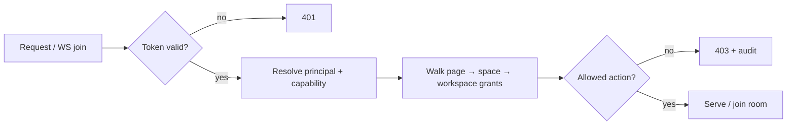

# Architecture

## 1. Context (C4 level 1)
```
 Users (desktop app · browser · mobile web)          Admins / Partners
          │  local-first edits, sync when online            │
          ▼                                                 ▼
 ┌─────────────────────┐   WebSocket (delta ops)   ┌────────────────────────┐
 │ Client (Tauri / Web)│ ◀───────────────────────▶ │ Wiro Server (Rust)     │──▶ IdP (OIDC/SAML)
 │ TS chrome + Rust/WASM│        HTTPS API          │ sync · API · auth ·     │──▶ SMTP
 │ engines              │                           │ storage · admin         │──▶ Object storage (S3-compatible)
 └─────────────────────┘                           └────────────────────────┘──▶ DB (ADR-0005)
                                                              │ optional ▶ AI endpoint (BYO model)
```

## 2. Client (C4 level 2)
| Layer | Tech | Responsibility |
|---|---|---|
| Shell | Tauri 2 (desktop) / browser (web) | windows, menus, FS, updates, deep links |
| Chrome UI | TypeScript + React + shadcn/ui, tokens | sidebar, panels, dialogs, settings, command palette |
| Docs editor | ProseMirror (ADR-0006) + loro-prosemirror | blocks, rich text, IME, a11y |
| Canvas | `wiro-canvas` + `wiro-render` (Rust→WASM, wgpu: WebGPU / WebGL2) drawing into `<canvas>` | scene graph, hit-test (`rstar`), culling/LOD, input, text (`parley`) |
| Core | `wiro-model`, `wiro-crdt`, `wiro-storage`, `wiro-sync`, `wiro-search`, `wiro-format` (WASM; native in Tauri side where useful) | data model, merge, persistence, sync, search, import/export |
| Bridge | `wasm-bindgen` + `tsify` (typed) | events/commands between chrome and engines; no JSON blobs on hot paths |

Data flow: user input → command → CRDT op → **local WAL write (IndexedDB/OPFS on web, SQLite on desktop)** → render → sync queue → server → broadcast → merge on peers.

## 3. Server
Single Rust binary (`axum` + `tokio`): WebSocket sync relay with per-document rooms, REST/JSON API (+ OpenAPI), auth (OIDC/SAML/magic link/passkeys), permissions, snapshotting & compaction of CRDT history, blob service (S3-compatible), search index (`tantivy`), audit log (append-only, hash-chained), admin API, webhooks, metrics (OpenTelemetry). Storage = PostgreSQL + S3-compatible blobs (ADR-0005). Stateless except storage → horizontal scale behind sticky WS routing.

## 4. Data model (simplified)
`Workspace → Space → Page{kind: doc|board|database, crdt_doc_id}`; Doc = block tree; Board = elements (sticky, shape, connector, text, frame, image, pen, table, embed) with transforms; Database = schema + rows (each row a page). Comments, presence, permissions are separate collections. IDs: UUIDv7.

## 5. Sync & offline
CRDT = **Loro** (ADR-0003): rich text, movable tree, maps, compact encoding, Rust + WASM, MIT. Delta compression; checkpoints; resumable upload; low-bandwidth mode drops presence frequency and media prefetch. Server is authority for permissions only, not for content merge.

## 6. Security
TLS everywhere; encryption at rest (server: envelope encryption with KMS/CMK; client: OS keychain-protected key on desktop); RBAC enforced server-side + signed capability tokens for guest links; audit log; SBOM + signed releases (Sigstore); `cargo deny` licence/advisory gate; CSP strict on web.

## 7. Deployment
| Target | Artefact |
|---|---|
| Dev / small | `docker compose up` (server + Postgres + MinIO) |
| Production / gov | Helm chart (RKE2/K3s), HA, backups, OTel |
| Air-gapped | offline bundle (images, chart, signatures, docs) |
| Managed (Team Cloud) | partner DCs in-country; per-country tenancy |

## 8. Quality attributes → tactics
| NFR | Tactic |
|---|---|
| P1 60 fps @10k | GPU renderer, spatial index, culling, LOD for text/images, dirty-rect, worker threads where available |
| R1 no data loss | WAL before ack, fsync on desktop, crash-recovery replay, chaos tests |
| O1 offline | everything local; server optional |
| B1 bandwidth | binary deltas, zstd, media transcoding server-side, lazy media |
| A1 a11y | DOM chrome; canvas object tree mirrored to accessible DOM list |

## 9. API
- REST/JSON over HTTPS, **OpenAPI 3.1** generated from Rust types (`utoipa`, MIT/Apache) and published with the server; typed TS client generated from it. Realtime = WebSocket (§11), not REST.
- Versioning: path prefix `/v1`; additive changes only within a major; deprecation header + 12-month window; webhooks versioned by payload `version` field.
- Resources: workspaces, spaces, pages, blobs, comments, members, permissions, audit, search, webhooks. Cursor pagination (`?cursor=&limit=`), `If-Match`/ETag on metadata, idempotency keys on POST.
- Errors: RFC 9457 `application/problem+json` (`type`, `title`, `status`, `detail`, `code`, `request_id`); stable machine codes; no internal details.
- Rate limits per token/IP with `Retry-After`; payload caps; all inputs validated at the edge.

## 10. Permissions model
- **RBAC**: roles `owner · admin · editor · commenter · viewer · guest` assigned at workspace, space or page level.
- **Inheritance**: workspace → space → page; most specific grant wins, explicit `deny`/restricted page breaks inheritance; effective permission computed server-side and cached.
- **Capability tokens** (guest/share links): signed (Ed25519), scoped to `{resource, actions, expiry, optional password}`, revocable via server deny-list; never grant above the issuer's rights.
- Enforcement: server filters sync rooms and API; clients receive only readable documents (per-doc rooms). Admin actions are audit-logged (hash-chained).
- Note: CRDT docs are not field-level secured; confidentiality unit = document (page). E2EE for selected pages is out of scope of this version (open question).



## 11. Sync protocol
Transport: WebSocket (binary frames, zstd-compressed batches), one multiplexed connection, room per document.
1. **Handshake**: `hello{protocol_version, client_id, auth, capabilities}` → server `welcome{server_version, limits}`; version mismatch → `426`-style close with upgrade hint.
2. **Join doc**: client sends Loro **version vector** of its local state; server replies with the missing updates (or a snapshot + updates if the gap is large) and its own vector; client pushes ops the server lacks. Peers then exchange incremental updates.
3. **Resume**: on reconnect repeat step 2 per open doc (idempotent, vector-based; no server session state required); exponential backoff + jitter.
4. **Backpressure**: per-room credit windows (server grants N bytes in flight); coalescing of updates (≤ 100 ms batches, longer in low-bandwidth mode); presence/cursors droppable and rate-limited; server can reply `slow_down`; oversized updates rejected with chunked upload path.
5. **Durability**: server ack only after WAL/DB commit; client keeps ops in local WAL until acked (R1).
6. **Compaction**: server snapshots + trims history by policy; shallow snapshots keep recent history for undo/version history.
Open (spike, Story 0.5/S1): Loro update encoding stability across versions → pin versions and test cross-version compatibility.

## 12. Observability
- OpenTelemetry (traces, metrics, logs) via `tracing` + `opentelemetry-otlp` (Apache-2.0); OTLP export optional, off by default (air-gapped friendly); `request_id`/`trace_id` in all logs and error bodies.
- Logs: structured JSON, no document content or PII; levels configurable.
- Key metrics: WS connections/rooms, sync apply latency p50/p95/p99, update size, queue depth/backpressure events, convergence lag, snapshot/compaction duration, DB/S3 latency, API latency/error rate by route, auth failures, storage growth, WAL replay count (client), crash-free sessions.
- Client telemetry is **opt-in**, anonymised, with local-only diagnostics export. Health: `/healthz`, `/readyz`; dashboards + alert rules shipped in the Helm chart.

## 13. Test strategy
| Level | Approach |
|---|---|
| Unit | per-crate `cargo test`, Vitest for TS chrome; coverage tracked, not gated blindly |
| Property-based | `proptest` on model invariants, permission resolution, normalisation (ADR-0007), codecs |
| CRDT convergence / fuzz | random concurrent op sequences across N replicas incl. offline/partition → assert identical state; `cargo-fuzz` on decoders (import formats, sync frames); cross-version update compatibility |
| Integration | server + Postgres + MinIO via testcontainers; sync protocol conformance suite |
| E2E | Playwright (web + Tauri WebDriver), multi-client collaboration, offline/online flips, IME/diacritics (Story 0.5) |
| Performance | canvas bench (ADR-0004), sync load tests (k6/own harness), budgets in §16 enforced in CI on reference machines |
| Chaos / durability | kill -9 mid-write, disk-full, network partition/latency injection (toxiproxy), restore-from-backup drills (R1) |
| Accessibility / i18n | axe + keyboard scripts; pseudo-localisation, RTL snapshots |
All licences of test tooling checked under the same allow-list.

## 14. Supply-chain security
`cargo deny` (licence allow-list + advisories) and JS licence-checker in CI (Story 0.2); `cargo audit`/OSV scan; lockfiles committed, pinned & reviewed updates (Renovate/Dependabot); `cargo vet` or equivalent for critical crates (loro, wgpu, axum); reproducible builds where feasible; SBOM (CycloneDX) per release; artefacts signed with Sigstore + provenance attestations (SLSA ≥ L2 target); GitHub Actions pinned by SHA, least-privilege tokens; secret scanning; WASM/engines built in CI only; clean-room guard report on PRs (AGENTS.md).

## 15. i18n / RTL
UI languages v1: FR, EN, then AR (RTL), and Wolof/Hausa/Yoruba/Swahili as community-driven. Strings externalised (ICU MessageFormat; `i18next`-style on TS, `fluent-rs`/ICU4X on Rust side), +30 % expansion tolerance (NFR-I1), logical CSS properties, mirrored layout & icons for RTL, bidi-aware text in editor and canvas (`parley` + ICU4X, MIT-style Unicode licence verified), fonts bundled/subset per script (Noto, OFL — fonts only, not code) with lazy load, IME composition safe in docs and canvas text, locale-aware dates/numbers/currency (XOF/NGN/KES), search normalisation (ADR-0007).

## 16. Performance budget (numbers; owned by NFR)
| Area | Budget |
|---|---|
| Canvas pan/zoom, 10k objects (NFR-P1) | 60 fps p50, ≥ 30 fps p95, on 4 GB/iGPU |
| Input latency (NFR-P2) | < 50 ms p95 |
| Cold start desktop / web shell (NFR-P3) | < 2 s / < 3 s on 3G-fast; initial web JS+WASM ≤ 1.5 MB gz |
| Renderer WASM / search WASM / CRDT WASM | < 600 KB / < 150 KB / < 400 KB gz [ASSUMPTION] |
| Memory 10k-object board (NFR-P4) | < 600 MB RSS desktop; < 400 MB @ 5k mobile |
| Sync | idle ≤ 1 MB/h (NFR-B1); op apply < 5 ms p95; reconnect-to-synced < 2 s on 3G for a 1 MB doc diff |
| Server | 1 vCPU/2 GB handles ≥ 200 concurrent editors [ASSUMPTION, to measure] |
| Search | < 50 ms p95 desktop (ADR-0007) |
Budgets are checked by the bench jobs (§13); regressions > 10 % fail CI.

## 17. ADR status
| ADR | Topic | Status |
|---|---|---|
| 0004 | Canvas rendering (vello_gpu/vello_cpu vs custom wgpu) + bench protocol | proposed — awaiting bench (S0, Story 0.4) |
| 0007 | Client search (own index + shared normaliser; tantivy server) | proposed — awaiting spike |
| 0008 | Mobile shell (PWA first, Tauri 2 mobile, TWA fallback) | proposed — awaiting Story 0.4 measures |
| 0009 | Legal/billing entity | proposed — skeleton, business decision by Jean Balin |
